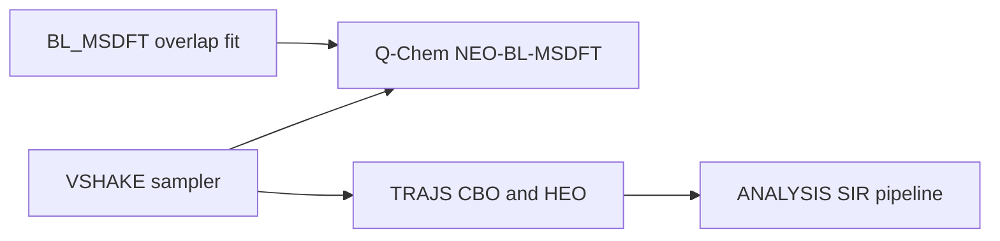

# V-SHAKE (NEO-MSDFT seam sampling)

Constrained molecular dynamics of the classical heavy-atom framework on the
nuclear-electronic orbital multistate DFT (NEO-MSDFT) vibronic diabatic seam

\[
\sigma(R) = E_D(R) - E_A(R) = 0.
\]

V-SHAKE is an adaptation of E-SHAKE (Cofer-Shabica, DeRosa, and Subotnik,
*J. Chem. Theory Comput.* **2026**, 22, 1575–1583). The transferring proton is
**not** a classical degree of freedom: Q-Chem reoptimizes the protonic basis
centers at every energy evaluation.

Production runs use a reparametrized NEO-BL-MSDFT overlap correction
(\(S' = \alpha S^\beta\)) for the PB4-D protonic basis. Sliced inverse
regression (SIR) on the sampled seam then finds the Cartesian motions that
modulate the vibronic coupling \(V = \Delta/2\); for the systems here that
direction is the donor–acceptor stretch.

## Repository layout

```
VSHAKE/      sampler (code, templates, driver)      → VSHAKE/README.md
TRAJS/       production CBO / HEO seam trajectories → TRAJS/README.md
ANALYSIS/    SIR + geometry pipeline on TRAJS       → ANALYSIS/README.md, SIR.md
BL_MSDFT/    FHF⁻ overlap-correction fit            → BL_MSDFT/README.md
```

## How the pieces connect



1. Overlap parameters live in [`BL_MSDFT/`](BL_MSDFT/); they are already fit
   for PB4-D.
2. Run V-SHAKE from [`VSHAKE/`](VSHAKE/) (or a copied case directory). Method,
   install, and templates: [`VSHAKE/README.md`](VSHAKE/README.md).
3. Production archives sit under
   `TRAJS/{CBO,HEO}/{HIGH,LOW}_TEMP/BATCH*/{H,D}/`. Layout:
   [`TRAJS/README.md`](TRAJS/README.md).
4. Analyze with `ANALYSIS/run_pipeline.sh --config {CBO,HEO}.yaml`. Pipeline
   and theory: [`ANALYSIS/README.md`](ANALYSIS/README.md) and
   [`ANALYSIS/SIR.md`](ANALYSIS/SIR.md).

## Systems

| System | Role | Donor–acceptor | Isotopes | Temperatures |
| --- | --- | --- | --- | --- |
| **CBO** | Intramolecular PT (`rxn1` MECP); 14 classical atoms; ANALYSIS also tracks a CN bend | C–O | H, D | 300 K (`LOW_TEMP`), 1000 K (`HIGH_TEMP`) |
| **HEO** | Acetylacetone-like enol (`acac` MECP); 11 classical atoms | O–O | H, D | 300 K (`LOW_TEMP`), 1000 K (`HIGH_TEMP`) |
| **FHF⁻** | Overlap-correction benchmark (not seam-sampled here) | F–F | H, D | — |

## Where to look next

- **[VSHAKE/README.md](VSHAKE/README.md)** — algorithm, install, Q-Chem templates, and run configuration. This is the canonical method document; this root README does not repeat it.
- **[TRAJS/README.md](TRAJS/README.md)** — production trajectory layout, per-run files, and density cubes.
- **[ANALYSIS/README.md](ANALYSIS/README.md)** — four-step SIR pipeline (gather XYZ, geometry scatters, SIR, PyMOL viz). **[ANALYSIS/SIR.md](ANALYSIS/SIR.md)** covers the theory.
- **[BL_MSDFT/README.md](BL_MSDFT/README.md)** — overlap-correction form, hybrid cost, and final \(\alpha\), \(\beta_{\mathrm{H}}\), \(\beta_{\mathrm{D}}\).
